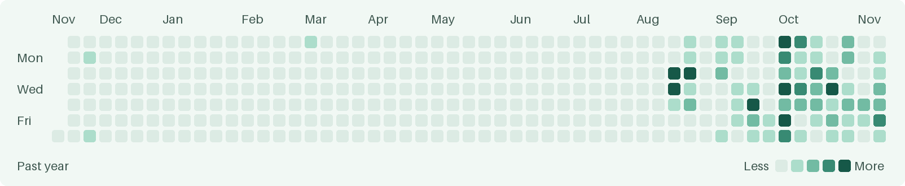

  <picture><source media="(prefers-color-scheme: dark)" srcset="./assets/tony-blur-dark.svg"></picture> 
  &nbsp;
  

  

## Minesweeper

<picture>
  <source media="(prefers-color-scheme: dark)" srcset="./assets/minesweeper-dark.svg">
  
</picture>

## GitHub activity

<picture>
  <source media="(prefers-color-scheme: dark)" srcset="./assets/contributions-dark.png">
  
</picture>

### Recent commits

<!-- recent-commits:start -->

- [Keep redirected stable feeds out of isolated builds](https://github.com/xiaotwu/Reremi/commit/f4e6614bea6fd8faa20316b6763405dc78ddfd58) · `Reremi` · Nov 14
- [Use Reremi in the active project and design guides](https://github.com/xiaotwu/Reremi/commit/e0a7845a04d945ed3446436bd7a99916b7553ea4) · `Reremi` · Nov 14
- [Adopt Reremi across the product and platform builds](https://github.com/xiaotwu/Reremi/commit/68572d665133e7c3a885acfd9f3193effcfd1d6b) · `Reremi` · Nov 13

<!-- recent-commits:end -->
