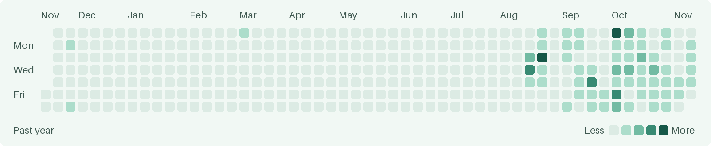

<h1 align="center">Tony</h1>

  <a href="https://www.linkedin.com/in/xiaotong-wu"><picture><source media="(prefers-color-scheme: dark)" srcset="./assets/linkedin-dark.png"></picture></a>&nbsp;
  <a href="https://xiaotong-wu.pages.dev/"><picture><source media="(prefers-color-scheme: dark)" srcset="./assets/website-dark.png"></picture></a>

  

## GitHub activity

<picture>
  <source media="(prefers-color-scheme: dark)" srcset="./assets/contributions-dark.png">
  
</picture>

### Recent commits

<!-- recent-commits:start -->

- [Initialize New\_Tasty from the licensed source snapshot](https://github.com/xiaotwu/New_Tasty/commit/3798175190966ecf63f37acea5c8d9cdcd967d5d) · `New_Tasty` · Nov 11
- [Initialize Link\_Prediction\_GAT from the licensed source snapshot](https://github.com/xiaotwu/Link_Prediction_GAT/commit/e3d72e8bfc5e86e6eebecc517e565c1da5044066) · `Link_Prediction_GAT` · Nov 11
- [Initialize OpenJam from the verified source snapshot](https://github.com/xiaotwu/Shiori/commit/ee38d87bf2ef431114c8b2b017b264b534ef8fc4) · `Shiori` · Nov 11

<!-- recent-commits:end -->
