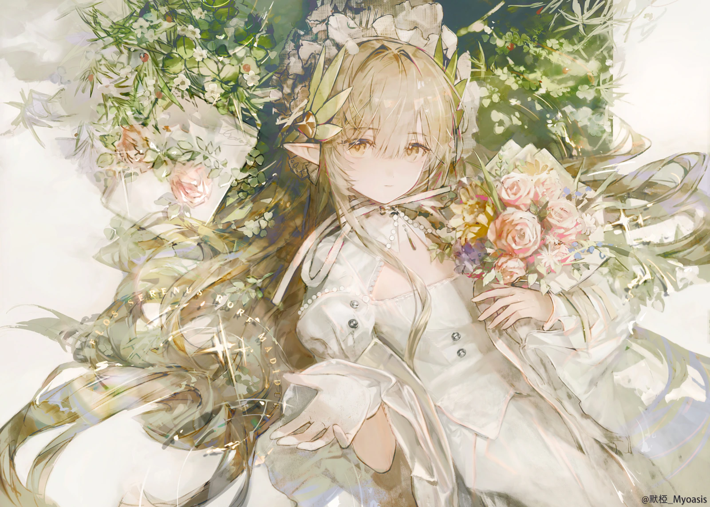

  <picture><source media="(prefers-color-scheme: dark)" srcset="./assets/tony-blur-dark.svg"></picture>

   
  Art by <a href="https://www.pixiv.net/en/artworks/149572350">默椏_Myoasis</a>

## Minesweeper

<picture>
  <source media="(prefers-color-scheme: dark)" srcset="./assets/minesweeper-dark.svg">
  
</picture>

## Activity

<picture>
  <source media="(prefers-color-scheme: dark)" srcset="./assets/contributions-dark.png">
  
</picture>
